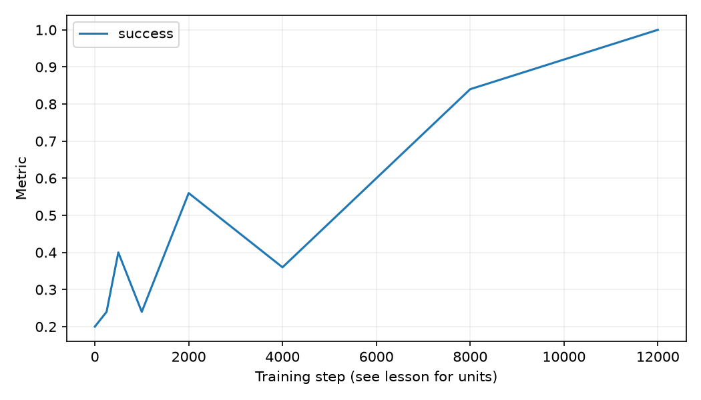

# DQN 整体实战：看到游戏、代码、标签与真实训练过程

2026-11-03 更新：本机 DQN/Rainbow 长训练均已停止。公开阅读优先看[精选真实录像、阶段分数与配置](evidence/breakout_20261102/README.md)，其中包含 DQN 318 分阶段的完整首局录像。下文的短训练与接球记录仍保留；长训练原始运行目录只留本机，未将大容量回放池和日志提交到 Git。

日期：2026-11-01。本次先串起整个流程，暂不要求深入解释目标网络为何稳定训练。全部代码用 PyTorch 手写 DQN，没有调用现成 RL Trainer。

## 先看最重要的区别：标签从哪里来

监督回归也好，DQN 的一次梯度更新也好，都会比较“预测数值”和“目标数值”。DQN 里的 TD target 就是本次回归的标签，不存在另一套另外定义的监督标签：

\[
y=r+\gamma(1-\mathrm{terminated})\max_{a'}Q_{\mathrm{target}}(s',a').
\]

它是一个浮点数，可能为负，不是正确动作的类别编号。环境给出执行结果与奖励，算法结合下一状态估值构造 y。我们没有人工标注“这帧应该向左”。同一条原始经历以后再被使用，标签也会按当时的目标网络重新计算。

整套系统仍然是强化学习：数据来自策略与环境交互，反馈用于改善决策；其中一个训练步骤表现为自举标签的回归。

## 完整流程只有这条主线

```text
初始化在线网络、目标网络、空经验池
             ↓
游戏给出当前观察 → 在线网络给各动作的 Q 值
             ↓
探索或取最大 Q → 实际按一个按钮 → 得到奖励和下一观察
             ↓
保存 (s, a, r, s_next, terminated)
             ↓
从经验池随机抽一批 → 算标签 y → 只监督执行过的动作 Q
             ↓
反向传播，更新在线网络 → 定期复制到目标网络
             ↓
继续交互，定期用固定规则评测和保存回放
```

“采样动作”与“从经验池采样训练数据”是两件事。一个 batch 的动作可以来自不同时间、不同回合的历史经历。网络每次输出所有动作，但一条经历直接监督的是当时所选动作对应的输出；共享参数可能间接改变其他输出。

## 先看已经真实学会的小游戏：接球

输入：两个通道的 6×5 网格，第一个标球，第二个标挡板。球每步落一行，挡板可左移、停留或右移。五次动作后接到得 +1，没接到得 −1；之前奖励为 0。这是独立教学环境，不是 Atari Breakout。

```text
输入 [B,2,6,5]
→ 展平为 [B,60]
→ Linear(60,64) + Tanh
→ Linear(64,64) + Tanh
→ Linear(64,3)
→ [Q_left, Q_stay, Q_right]
```

输出不经过 softmax。本次网络 8,259 个参数，CPU 单线程，seed=0，训练 12,000 次环境动作。每次评估完整枚举 25 种“球初始列×挡板初始列”，不是抽取 25 个新任务。

| 已训练环境动作数 | 已更新参数次数 | 成功率 | 同种子真实回放与逐局动作 |
|---:|---:|---:|---|
| 0 | 0 | 20% | [GIF](runs/catch_20261101/step_00000/play.gif) · [25 局](runs/catch_20261101/step_00000/evaluation.json) |
| 250 | 31 | 24% | [GIF](runs/catch_20261101/step_00250/play.gif) · [25 局](runs/catch_20261101/step_00250/evaluation.json) |
| 500 | 94 | 40% | [GIF](runs/catch_20261101/step_00500/play.gif) · [25 局](runs/catch_20261101/step_00500/evaluation.json) |
| 1,000 | 219 | 24% | [GIF](runs/catch_20261101/step_01000/play.gif) · [25 局](runs/catch_20261101/step_01000/evaluation.json) |
| 2,000 | 469 | 56% | [GIF](runs/catch_20261101/step_02000/play.gif) · [25 局](runs/catch_20261101/step_02000/evaluation.json) |
| 4,000 | 969 | 36% | [GIF](runs/catch_20261101/step_04000/play.gif) · [25 局](runs/catch_20261101/step_04000/evaluation.json) |
| 8,000 | 1,969 | 84% | [GIF](runs/catch_20261101/step_08000/play.gif) · [25 局](runs/catch_20261101/step_08000/evaluation.json) |
| 12,000 | 2,969 | 100% | [GIF](runs/catch_20261101/step_12000/play.gif) · [25 局](runs/catch_20261101/step_12000/evaluation.json) |



这些 GIF 来自模型实际选择的动作；各阶段使用相同回放种子与四局初态，不是手工编排。只做了一个训练种子，不据此给出算法排名。最终权重重新加载后仍通过 25/25，见 [独立核对](runs/verification.json)。

## 原论文真实游戏：Atari Breakout

DQN 早期工作为 [Playing Atari with Deep Reinforcement Learning（2013）](https://arxiv.org/abs/1312.5602)。这里的 CNN 结构对照 [2015 Nature 论文](https://deepmind-media.storage.googleapis.com/dqn/DQNNaturePaper.pdf)；该版本用相同结构与算法设置分别训练多个 Atari 游戏，其中包含 Breakout，不能理解为一份统一权重同时掌握所有游戏。作者原始代码是 [Lua/Torch 实现](https://github.com/google-deepmind/dqn)。

我们运行的是真实 ALE 模拟器中的 `ALE/Breakout-v5`，不是自写的打砖块替代游戏。原始画面为 210×160×3；预处理灰度化、缩放到 84×84，将四帧叠起来，以提供球运动的信息。一次决策重复动作四帧。基础环境设置 frameskip=1，预处理层再重复四帧，避免重复两次跳帧。

本次实际动作空间：

| 动作编号 | 模拟器动作 |
|---:|---|
| 0 | NOOP，不动 |
| 1 | FIRE，发球 |
| 2 | RIGHT，右移 |
| 3 | LEFT，左移 |

每次重置后由包装器发球一次，后续动作由策略选择，包括掉命后的再次发球。训练奖励取原分数变化的 sign；评测保存未裁剪游戏分数。

### 实际网络结构

```text
输入 uint8 [B,4,84,84] → 转 float 并除以 255
→ Conv2d(4,32, kernel=8,stride=4) + ReLU → [B,32,20,20]
→ Conv2d(32,64,kernel=4,stride=2) + ReLU → [B,64,9,9]
→ Conv2d(64,64,kernel=3,stride=1) + ReLU → [B,64,7,7]
→ Flatten → [B,3136]
→ Linear(3136,512) + ReLU
→ Linear(512,4)
→ 当前四个动作的 Q 值
```

共 1,686,180 个参数。读 [breakout.py 的 NatureQNet](breakout.py)。具体预处理与动作参数以 [ALE 官方文档](https://ale.farama.org/environments/breakout/) 和 [Gymnasium 包装器说明](https://gymnasium.farama.org/api/wrappers/misc_wrappers/) 为参考，实际实测版本保存于 [配置](runs/breakout_smoke_20261101/config.json)。

### 本次实际跑到了哪里

真实 Breakout 已完成 **256 次训练决策、49 次梯度更新**，不是只创建环境。训练前后各用相同种子和 200 次决策预算做贪心短评测，得分均为 **0**。这是链路验证，尚没有学会游戏的证据；训练探索期间未结束的一局获得过 1 分，不能把它当作训练后能力提升。

- [训练前真实回放](runs/breakout_smoke_20261101/before.gif) · [训练后真实回放](runs/breakout_smoke_20261101/after.gif)。
- [训练前每一步动作与 Q 值](runs/breakout_smoke_20261101/before_evaluation.json) · [训练后](runs/breakout_smoke_20261101/after_evaluation.json)。
- [实际 49 次更新日志](runs/breakout_smoke_20261101/train.jsonl) · [结果](runs/breakout_smoke_20261101/results.json)。
- 实际网络输入的 [第 1 帧](runs/breakout_smoke_20261101/input_frame_0.png)、[第 2 帧](runs/breakout_smoke_20261101/input_frame_1.png)、[第 3 帧](runs/breakout_smoke_20261101/input_frame_2.png)、[第 4 帧](runs/breakout_smoke_20261101/input_frame_3.png)。重置时历史帧按同帧填充，之后叠帧随交互滚动。

这次首批 loss 约 0.001076，最后一批约 0.000000433；任务短评测仍为 0。两批数据并不相同，不能据 loss 下降宣称游戏水平提高。

原论文使用大规模采样与训练，本次 CPU 阅读版不是其完整协议复现：这里采用 Adam、Huber loss、小经验池、整局终止、不使用 sticky actions；未将每次掉命定义成训练终止。该脚本目前只有 CPU 路径，尚未完成 CUDA/昇腾加速适配。扩大训练前先实测吞吐和预算，不承诺短时间达到论文分数。

## 只看这几行，就能对上“输入、输出、标签、损失”

两款游戏共用 [dqn_core.py](dqn_core.py)：

```python
# states: 一批真实观察；actions: 当时实际执行的动作
prediction = online(states).gather(1, actions[:, None]).squeeze(1)

with torch.no_grad():
    next_value = target_net(next_states).max(dim=1).values
    label = rewards + gamma * (1 - terminated) * next_value

loss = F.smooth_l1_loss(prediction, label)
optimizer.zero_grad()
loss.backward()
optimizer.step()
```

这是对完整实现的核心摘录；实际实现另外逐项记录 Huber loss，并在 step 前做梯度裁剪。`actions` 用于选出哪个输出接受监督；`label` 才是回归标签。`target_net` 是网络，`label` 是该网络与环境反馈共同构造出的本次数值，两个词不要混在一起。

## 打开真实的一批训练数据

- 接球：[64 条逐项标签与损失](runs/catch_20261101/first_batch/loss_batch.json) · [原始张量 NPZ](runs/catch_20261101/first_batch/batch_inputs.npz)。
- Breakout：[16 条逐项标签与损失](runs/breakout_smoke_20261101/first_batch/loss_batch.json) · [原始像素张量 NPZ](runs/breakout_smoke_20261101/first_batch/batch_inputs.npz)。

例如接球本次真实首条样本：实际动作为 RIGHT，奖励 0，未终止，下一状态最大估计为 0.1585894227；标签约为 `0 + 0.99 × 0.1585894227 = 0.1570035368`，在线网络预测为 0.1303839535。这里没有人告诉它 RIGHT 是正确动作；这条样本只告诉它该动作发生后，环境给出了什么。抽到终局经验时，标签直接是奖励。

独立核对会从原始字段重算全部标签与 Huber 损失，并检查终止 mask、数据量和检查点回放，见 [verification.json](runs/verification.json)。

## 自己运行，保留每个阶段

本机 GPU 的半小时训练入口是 `train_breakout.py`，快速说明见
[本机GPU打砖块速读](本机GPU打砖块速读.md)。它继续使用同一个 `dqn_core.update`，
并保存训练前、每五分钟和最终的模型、固定种子分数及真实游戏录像。

```bash
.venv/bin/python grpo_lab/guard.py --log /tmp/breakout_gpu_resources.jsonl --max-seconds 2400 -- .venv/bin/python dqn_lab/train_breakout.py --out dqn_lab/runs/my_breakout_gpu --device mps --seconds 1800
```

输出目录必须是新目录。继续同一个实验时，加 `--resume` 并保持原超参数；它恢复最新的
网络、优化器、随机状态和回放池，环境重置为新一局。
`verify_atari_run.py <运行目录>` 可独立核验分数、视频与重新加载模型的实际推理。

先亲手玩原版 Atari（不加载模型、不训练）：

```bash
.venv/bin/python dqn_lab/play_atari.py
```

窗口内按 `1/2/3` 切换 Breakout、Pong、Space Invaders。打砖块和太空侵略者用
左右方向键或 `A/D` 移动；Pong 用上下方向键或 `W/S` 移动右侧挡板。
空格开始/发球/射击，`P` 暂停，`R` 重开。`Esc` 不执行操作，关闭窗口退出。
初始及失去焦点时暂停。
轻按方向键只微移一次；长按约 0.22 秒后才开始重复移动，按住 `Shift` 可快速移动。
打砖块试玩使用原生模拟挡板的较低移动强度，方便精确对准；这些设置仅影响人工试玩，
训练入口仍使用离散动作与原有预处理。
这是后续训练使用的同一套 ALE 原版游戏，试玩显示彩色原画面。

在仓库根目录使用已有 `.venv`。本机环境由 uv 管理，若没有 pip，可使用下列 uv 命令；另建环境时也可以使用 pip 安装 requirements。

```bash
uv pip install --python .venv/bin/python -r dqn_lab/requirements.txt

# 快速完整学习：输出目录必须是新路径，避免覆盖已有证据。
.venv/bin/python grpo_lab/guard.py --log /tmp/my_catch_resources.jsonl --max-seconds 180 -- .venv/bin/python dqn_lab/catch.py --out dqn_lab/runs/my_catch

# 原版 Breakout 的短链路验证，不代表训练收敛。
.venv/bin/python grpo_lab/guard.py --log /tmp/my_breakout_resources.jsonl --max-seconds 240 -- .venv/bin/python dqn_lab/breakout.py --out dqn_lab/runs/my_breakout --steps 256 --learning-starts 64 --buffer-size 1000 --batch-size 16 --eval-steps 200
```

接球在每个保存阶段打印成功率，输出 `progress.jsonl`、回放 GIF、全 25 初态的动作轨迹和本机检查点。演示期间可以先看已有 GIF，再从新目录运行并观察这些阶段。不要把中间回落藏起来；成功率和 loss 要分别看。

两次运行都用本项目 guard 检查 CPU、可用内存和系统热状态，并仅暂停自己启动的进程。实测依赖见 [requirements-tested.txt](requirements-tested.txt)，负载采样见各运行目录的 `resources.jsonl`。没有读取具体摄氏温度。

## Rainbow 本机训练

新增六组件 Rainbow：Double DQN、Dueling、C51、优先回放、多步回报和 NoisyNet。代码入口是 `train_rainbow.py`，核心网络/更新在 `rainbow_core.py`，磁盘帧回放和 PER 在 `rainbow_replay.py`。与旧 DQN 使用独立运行目录。

具体张量形状、训练配方、启动与续训、评估证据及恢复边界见 [Rainbow 本机实验说明](Rainbow本机实验说明.md)。关键 CPU 语义检查：`.venv/bin/python dqn_lab/test_rainbow.py`。完整 Rainbow 不等于原论文配方逐项复刻，正式成绩以实际保存的评估记录为准。
