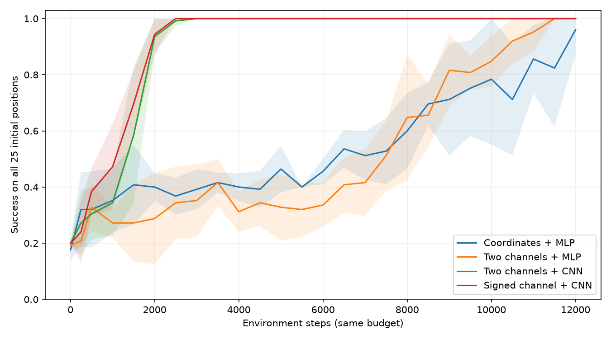
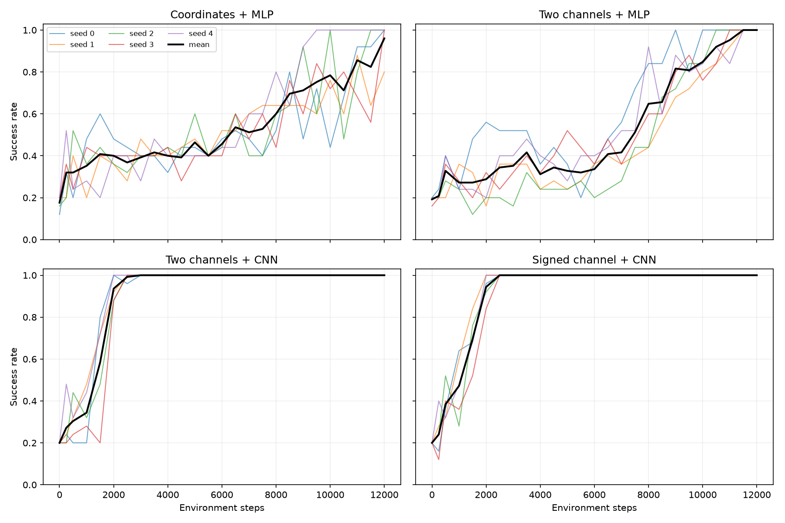

# 接球 DQN：坐标、网格与卷积网络的真实对照

日期：2026-11-01。四组各 5 个训练种子，共 20 次独立训练；每次固定 12,000 个环境步、2,969 次梯度更新，串行 CPU 单线程。没有按结果挑选种子、延长个别运行或提前停止。

本次固定配方下，两种网格 CNN 在相同环境步预算下更早达到高成功率；坐标 MLP 也能学会任务，但 5 个种子中有 1 个在固定末步只有 80%，所以末步均值为 96%。两种 CNN 与双通道 MLP 的末步五个种子均为 100%。这支持“不同表示与网络配方的成长曲线确实不同”，不能单独证明差异全来自卷积的空间归纳偏置。

这里比较的是相同采样与梯度更新预算。CNN 的单次更新更贵；固定 12,000 步的整段训练/评估每个种子约需 6 秒，MLP 约 2.3 秒（本机采样值），所以更早在曲线上学会，不等于每秒训练吞吐更高。

## 主结果

| 表示与模型 | 参数量 | 最终成功率均值 ± 种子间样本标准差 | seed 0–4 最终成功率 | 曲线面积均值 |
|---|---:|---:|---|---:|
| 坐标 MLP | 4,611 | 96.0% ± 8.9% | 100% / 80% / 100% / 100% / 100% | 0.5368 |
| 双通道网格 MLP | 8,259 | 100.0% ± 0.0% | 100% / 100% / 100% / 100% / 100% | 0.5194 |
| 双通道网格 CNN | 32,299 | 100.0% ± 0.0% | 100% / 100% / 100% / 100% / 100% | 0.9071 |
| 单通道有符号网格 CNN | 32,227 | 100.0% ± 0.0% | 100% / 100% / 100% / 100% / 100% | 0.9196 |

曲线面积为在观测检查点间做梯形积分，再除以 12,000 步，取值约 0–1，较高表示相同采样预算下更早、更持续地成功。它不是泛化成绩或统计显著性。



阴影为五个种子间的样本标准差，已裁剪到 0–1 显示，并非置信区间。折线仅连接离散检查点，不表示未测时刻的实际轨迹。



## 实验到底控制了什么

- 物理规则、奖励、动作、回合终止保持原 Catch 不变：球每步下落一行，五步后接到 +1、否则 −1；无中间距离奖励。
- 同一训练种子使用相同环境初态序列，并保存逐回合位置表与哈希。不同策略的动作及经历自然不同；不能要求策略改变时整条轨迹不变。
- 使用同一份 dqn_core.update，Adam lr=0.001、gamma=0.99、batch=64、经验池=10,000、warmup=128、每四步更新、每 200 环境步同步目标网络。epsilon 按同一固定 12,000 步日程下降至 0.05。
- 在 0、250、500 步及之后每 500 步，贪心评估全部 25 个球列×挡板列初态。每次评估记录各局五个动作和结果，不只保存均值。
- 坐标为球行/5、球列/4、挡板列/4；未手工提供相对距离或正确动作。单通道为球 +1、挡板 −1、同格 +2。编码检查枚举 150 个位置状态，确认每种表示都保留不同状态，不因终局重叠抵消。

## 如何解释与不能推出什么

坐标数值确实可以表达位置规律，MLP 可以拟合其中的关系；二维网格则给 CNN 提供了局部连接、权重共享的空间归纳偏置。实际学习快慢必须看上面的曲线，不能仅凭“有空间结构”或“输入更小”断言某组更好。
这不是严格的参数量匹配实验：坐标与网格 MLP 第一层输入大小不同；CNN 和 MLP 的参数量、激活函数、结构也不同。因此不能把不同组的全部差异单独归因于表示形式或卷积。双通道 MLP 与 CNN 是相同表示下的模型配方比较；双通道和有符号 CNN 是接近的结构、但并非完全相同参数量的编码比较。
四组输入都是已由环境提供对象位置的编码。坐标直接显式提供位置，网格也已经标出了对象，并不是原始 Atari 视觉识别任务。这项有限状态任务上的表现不能推广为所有游戏、视觉问题或新物理规则的结论。
首次达到某阈值仅指离散检查点中第一次观察到，后面可能回落；不叫已经收敛。不同种子的原始阈值与曲线都保留。五个种子提供一定重复证据，但不能证明某架构普遍占优。

## 原始数据与验证

- [全部配置、逐种子指标与逐阶段聚合](summary.json)。
- [编码信息保留检查](encoding_checks.json) · [运行后独立核验](verification.json)。
- 每组目录内的 seed_0 到 seed_4，learning_curve.json 保存全部检查点；evaluations.jsonl 保存每个检查点完整 25 局的初态、动作和结果；metrics.json 保存末步成绩、首次阈值、重载检查与初态哈希。
- 每次运行 model_config.json 保存完整结构与参数量；first_batch 保存真实输入 NPZ、预测、标签和逐项损失。model.pt 只在本机保留，按仓库规则忽略。
- [资源日志](resources.jsonl) · [资源采样摘要](resource_summary.json) · [冻结配置](config.json)。采样值不等于连续峰值，热状态不是摄氏温度。

## 复现

在仓库根目录使用新输出目录，并通过现有 guard 监控；本程序拒绝覆盖已有目录。

```bash
.venv/bin/python grpo_lab/guard.py --log /tmp/my_representation_resources.jsonl --max-seconds 900 -- .venv/bin/python dqn_lab/representation_ablation.py --out dqn_lab/runs/my_representation
```

本次没有改变主对话正在阅读的环境、训练循环或 DQN 核心代码，也没有提交或推送。

## 各采样预算下的成功率均值

| 环境步数 | 坐标 MLP | 双通道 MLP | 双通道 CNN | 单通道 CNN |
|---:|---:|---:|---:|---:|
| 0 | 17.6% | 19.2% | 20.0% | 20.0% |
| 250 | 32.0% | 20.8% | 27.2% | 24.0% |
| 500 | 32.0% | 32.8% | 30.4% | 38.4% |
| 1000 | 35.2% | 27.2% | 34.4% | 47.2% |
| 2000 | 40.0% | 28.8% | 93.6% | 94.4% |
| 4000 | 40.0% | 31.2% | 100.0% | 100.0% |
| 8000 | 60.0% | 64.8% | 100.0% | 100.0% |
| 12000 | 96.0% | 100.0% | 100.0% | 100.0% |

每格为五个预先固定种子的均值，不是最佳种子或最佳检查点。
资源采样共 20 次，热状态取值为 [0]；CPU 最高采样值 19.4%，任务 RSS 最高采样值 0.36 GiB，可用内存最低采样值 16.17 GiB，保护暂停采样 0 次。
