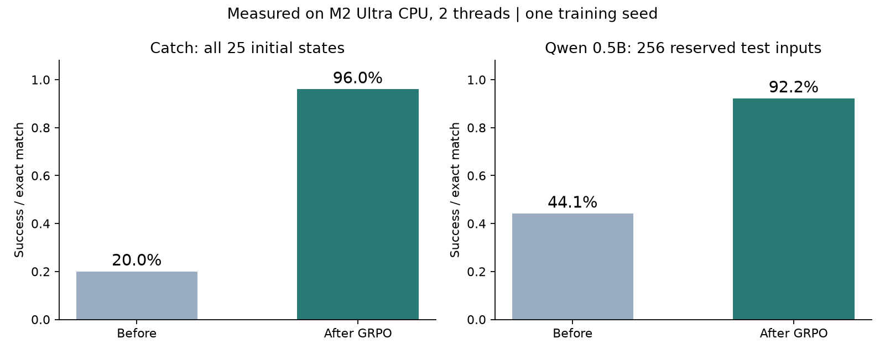

# 本机 GRPO 实战：训练完成与验证报告

完成日期：2026-09-14。游戏与真实预训练语言模型均达到事前定义的目标，已停止训练。没有使用云显卡或付费 API。

**2026-10-26 重复推理核验：** 从已保存的基础模型权重与第 20 步 LoRA 加载，在同一 256 题上重新贪心生成，仍为 113/256 与 236/256，逐题输出与本报告原始记录全部一致。见 [训练前完整记录](runs/inference_audit_20261026/01_训练前推理记录.md)、[训练后完整记录](runs/inference_audit_20261026/02_训练后推理记录.md)。本次核验没有重新训练或增加独立测试题；原训练与测试选取边界仍按下文说明。

| 任务 | 训练前 | 训练后 | 评价范围 |
|---|---:|---:|---|
| Catch 接球 | 20.0% | 96.0% | 全部 25 个初始位置组合，五步预算 |
| Qwen 0.5B 数字反转 | 113/256（44.1%） | 236/256（92.2%） | 预先保留、从未用于选检查点的 256 道题 |

## 目标与完整经过

游戏要求至少 95%，在第 20、30 次更新均达到 96%，故结束。随机策略在另 500 局为 19%；该数值与完整枚举评估口径不同，仅作参考。保存模型重新加载后仍为 96%。

LLM 要求独立任务集正确率至少 80%，并较基础模型增加至少 20 个百分点。第 10 步在 32 题验证集达到 90.6%，但首次 128 题测试只有 78.1%，没有达标。该失败保留，并承认这批测试已经查看。随后将开发验证扩大为完整 128 题，并在继续训练前固定一组新的 256 题最终测试集。第 20 步的完整验证为 87.5%，据此冻结模型，再评估最终集得到上表结果。

新最终集是原始固定打乱数据池的 `[1280:1536]`，与训练、验证和第一次测试完全不重叠。没有因最终测试结果继续调参；选取记录、时间与 adapter 哈希可核对。

最终提高 48.0 个百分点：纠正 125 道，另有 2 道由对变错。按题配对 bootstrap 的增益 95% 区间约 41.8–54.3 个百分点；它反映这类输入抽样的不确定性，不覆盖多次训练随机种子的变化。

## 实际训练了什么

- 游戏：MLP 策略；同一初态 16 次尝试，完整回合奖励，组内相对优势，clip=0.2；无 Critic，熵系数 0.01。
- LLM：真实 Qwen2.5-0.5B-Instruct，FP32；在 Q/K/V/O 投影上训练 rank=8 的 LoRA，共 1,081,344 个可训练参数；基础模型权重冻结。
- 本次不做 SFT 热身；基础模型本身是既有指令模型。损失只使用模型实际采样答案的 log-prob 与结果奖励，正确答案仅供评分。
- 每次取两个 prompt，每题 8 个候选，最长生成 8 token，temperature=1、top-p=1、top-k=0；有组内分差时执行两轮更新。无参考 KL。
- 共 20 次采样迭代，其中 14 次产生有分差的组；实际优化器更新 28 次。训练迭代自身记录耗时合计 168.4 秒，不包括下载、加载、评估、阶段间工作和主动休息。

## 错误与改进样例

| 输入数字 | 正确结果 | 基础模型输出 | GRPO 输出 |
|---|---|---|---|
| `9701` | `1079` | `0179` | `1079` |
| `4124` | `4214` | `124` | `4214` |
| `1555` | `5551` | `5515` | `5551` |
| `1191` | `1911` | `191` | `1911` |
| `9073` | `3709` | `7309` | `3709` |
| `6973` | `3796` | `7396` | `3796` |

以下是退化样例，全部保留：

| 输入数字 | 正确结果 | 基础模型输出 | GRPO 输出 |
|---|---|---|---|
| `3966` | `6693` | `6693` | `6699` |
| `9397` | `7939` | `7939` | `7793` |

## 电脑负载与热状态

M2 Ultra、64GB，CPU 两线程、nice 10。每五秒采样的记录中：系统 CPU 使用率最高 22.3%，任务 RSS 最高 2.61GiB，系统可用内存最低 14.12GiB。所有热状态记录均为 nominal（0），没有保护暂停。

这些是采样值而非连续峰值测量；没有读取具体摄氏温度，不能声称温度绝不升高。监护程序在热状态达到 fair、内存不足或负载超阈值时暂停自己的进程组，且支持中断清理。用户的高负载保护要求已写入全局 AGENTS 与记忆。

## 验证与复现入口

GRPO 分组／停止梯度／mask 与保护条件检查通过。真实预训练模型的生成 log-prob 与重新前向计算最大差 4.89e-05，低于设定容差 1e-4；该检查包含左侧 padding 和 EOS。最终 adapter 哈希与测试前冻结记录一致。

- [使用说明与重跑命令](README.md)
- [共享 GRPO 损失](core.py) · [游戏训练](game.py) · [LLM 训练](llm.py) · [负载保护](guard.py)
- [游戏原始结果](runs/game/results.json) · [训练前回放](runs/game/before.gif) · [训练后回放](runs/game/after.gif) · [重新加载回放](runs/game/reloaded.gif)
- [LLM 配置](runs/llm_reverse/config.json) · [逐步日志](runs/llm_reverse/train.jsonl) · [最终对比 JSON](runs/llm_reverse/final_comparison.json)
- [最终测试：基础模型逐题输出](runs/llm_reverse_base_final/final_test_0000_256.json) · [最终测试：GRPO 逐题输出](runs/llm_reverse/final_test_0020_256.json)
- [最终选取记录](runs/llm_reverse/selection.json) · [初次未达标后的决策](runs/llm_reverse/stage2_decision.json) · [概率核验](runs/llm_reverse/logp_check.json)
- [监护进程中断清理检查](runs/guard_cleanup_check.json)
- [资源采样汇总](runs/resource_summary.json) · [模型来源与 revision](model_source.json) · [实测依赖](requirements-tested.txt)

最终 LoRA 权重位于 `runs/llm_reverse/adapter/`，恢复状态位于 `training_state.pt`，第 10、20 步归档位于 `checkpoints/`。原始权重缓存位于 `.cache/qwen/`。这些权重保留供本机重跑，已列入忽略规则。

## 结果边界

接球是有限小环境；LLM 只验证同分布四位数字字符串反转。没有验证 Mario、一般数学推理、编程或长程 Agent，也没有运行多个训练种子。这里证明的是手写 GRPO 能在真实预训练模型上形成可测的任务改善，不是通用能力的整体提升。
