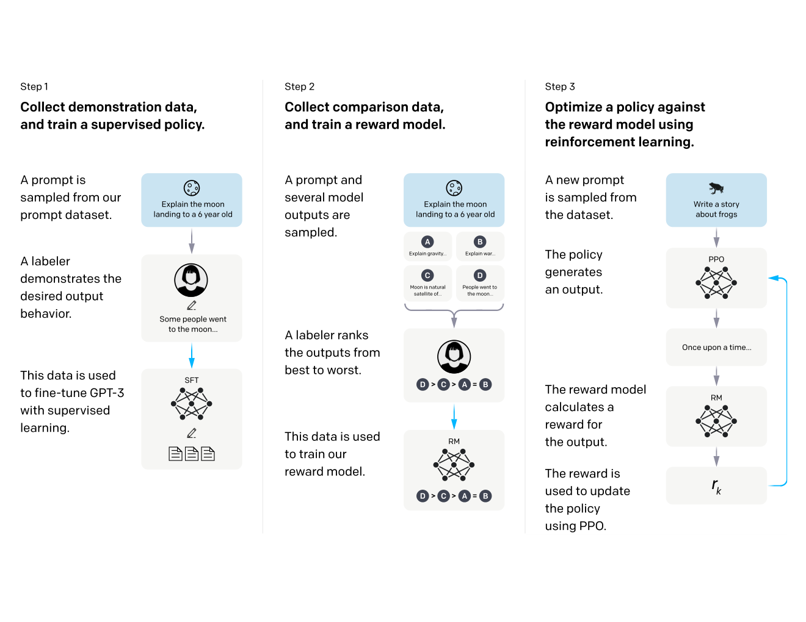

# 从 GPT‑3 到 InstructGPT

## 开场讲述顺序

### 第 1 页 · 从会续写，到会回应指令

请模型用法语写个故事，讲一只青蛙穿越到古希腊。GPT‑3 接着列了几道新的作文题，InstructGPT 开始讲青蛙的故事。[InstructGPT 图 8](https://arxiv.org/html/2203.02155v1#S4.F8)

**图前一句。** 自监督预训练通过预测文本的下一个 token，得到基础 GPT‑3。下图从这个基础模型出发。[GPT‑3 原论文](https://arxiv.org/abs/2005.14165)

图 2 来自 Ouyang 等人的 InstructGPT 论文。[查看原图与图注](https://arxiv.org/html/2203.02155v1#S1.F2)

**口述。**「GPT‑3 已经会写法语，可用户交代的故事还没开始。看图左边，研究者先让人写示范，用 SFT 教模型怎么回应。再看中间，人可以比较模型写出的几份回答，把偏好教给奖励模型。到了右边，图里换了一道青蛙题。策略自己生成一份新回答，由奖励模型评分，再用 PPO 更新策略。」

### 第 2 页 · 从学示范，到学怎样拿到更好的结果

| 学高手落子 | 用一局的结果学习 |
|---|---|
| 棋谱告诉模型，高手在这个局面下了哪一手。模型学习提高那一手的概率。 | 模型自己选动作，走完得到胜负反馈。训练让它以后更容易赢。 |

**口述。**「预训练和 SFT 都有具体要预测的 token。在棋谱里，每一步也有现成的示范。自己下棋时，可以只用终局的输赢作为反馈，学出以后更容易赢的策略。在线训练大模型时，也是先让策略自己生成回答，再用它实际得到的反馈来学习。」

**过渡。**「给反馈的也可以是游戏规则或判题程序。下面我们看一局小游戏，看看一整局的结果是怎么用来改进每一步决策的。」

## 开场讲者备查

- 图 2 是后训练流程。前两栏以登月解释为例，第三栏用的是简短的青蛙故事提示。开场的法语版「青蛙穿越到古希腊」来自图 8，是论文挑来展示行为的另一个例子。要讨论 PPO 相对 SFT 的贡献，可以看有 SFT 对照的偏好评估。[InstructGPT §3.6，图 3](https://arxiv.org/html/2203.02155v1#S3.SS6)
- 围棋是教学对照。只在胜局给 1 分，其他结果给 0 分，且不折扣时，预期回报等于胜率。「当前策略自己生成回答」描述在线 PPO、GRPO 的采集过程。模型生成的文本经筛选也可以成为 SFT 的监督目标。
- PPO 和 GRPO 都可以接规则奖励。DeepSeekMath 的 GRPO 实验使用奖励模型，并用同题多答的相对分数替代学习得来的 Critic。DeepSeek‑R1‑Zero 后来把 GRPO 与规则奖励结合。[PPO 原论文](https://arxiv.org/abs/1707.06347) · [DeepSeekMath §4](https://arxiv.org/html/2402.03300v3#S4) · [DeepSeek‑R1 §2.2.2](https://arxiv.org/html/2501.12948v1#S2.SS2.SSS2)

## 后半场可取用的论文动机

| 到哪一段 | 上一讲法遇到什么问题 | 新方法做了什么 |
|---|---|---|
| REINFORCE | 环境只能给出结果，梯度怎么回到随机采样的策略？ | 对实际动作的对数概率求梯度，用回报给它加权。[Williams，1992](https://doi.org/10.1007/BF00992696) |
| 基线与 Actor–Critic | 同一个动作好坏要看局面，直接用单条回报得到的梯度估计波动很大。 | 用当前局面的期望回报作参照。Actor 决定怎么行动，Critic 学习给出这个参照。之后可以用 GAE 把相邻步的价值估计和奖励结合起来。[策略梯度方法](https://proceedings.neurips.cc/paper_files/paper/1999/hash/464d828b85b0bed98e80ade0a5c43b0f-Abstract.html) · [GAE 原论文](https://arxiv.org/abs/1506.02438) |
| PPO | 采一批数据成本不低，重复多次更新又可能把当前策略推得太远。 | PPO‑Clip 用当前策略与采集策略的概率比，限制继续扩大某些已跨过阈值的改动所能带来的目标收益。[PPO 原论文 §3](https://arxiv.org/pdf/1707.06347#page=3) |
| GRPO | 给语言模型额外训练 Critic 有算力和显存开销，整段打分也让逐 token 估值变难。 | 让旧策略对同一道题生成多份回答，从同题分数构造优势。DeepSeekMath 的目标保留了 PPO 风格的概率比裁剪以及对参考策略的 KL 项。[DeepSeekMath §4.1](https://arxiv.org/html/2402.03300v3#S4.SS1) |

## 现场可能被追问的三个点

- **「SFT 和 RL 的损失哪里不同？」** SFT 优化示范 token 的对数似然。RL 从策略采样，再用奖励导出的信号决定怎样调整这些样本动作的概率。奖励模型还有自己的训练目标，在 InstructGPT 中来自同题偏好比较。
- **「模型自己生成的所有东西都鼓励吗？」** 优势提供方向。以同一局面通常能拿到的回报为参照，表现更好的样本可以给正优势，表现更差的样本可以给负优势。等听众看到游戏里的高低分轨迹，再讲这个词。
- **「为什么偏偏是 PPO 或 GRPO？」** 开场只说明论文分别采用了什么。后半场再解释 PPO 的批次复用和裁剪，以及 GRPO 怎么用同题多次采样构造优势。对语言模型，可固定同一个判题规则来对照这两种更新方式。
