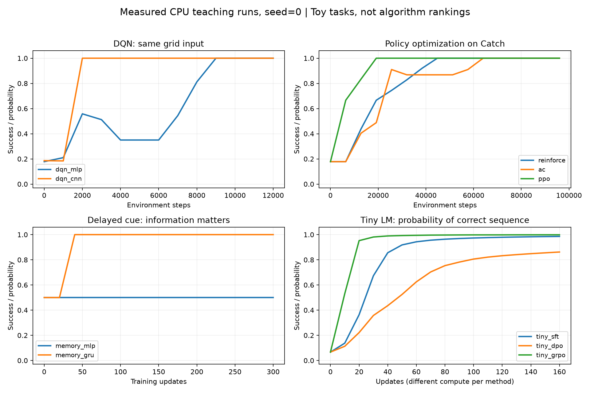

# 本机实验记录

由 `code/summarize_runs.py` 从各实验的 `results.json` 自动汇总。每项训练 seed=0；未做多 seed 算法排名。全部使用 CPU。运行时长是脚本记录值，不包含安装依赖，也不是其他机器的耗时保证。

| 实验 | 训练前 | 训练后 | 参数量 | 记录时长／秒 | 原始记录 |
|---|---:|---:|---:|---:|---|
| bandit | 0.467 | 0.882 | 不适用 | 0.625 | [JSON](runs/bandit/results.json) |
| q_table | 未测 | 到达终点 | 不适用 | 0.06 | [JSON](runs/q_table/results.json) |
| dqn_mlp | 0.178 | 1.000 | 8259 | 4.711 | [JSON](runs/dqn_mlp/results.json) |
| dqn_cnn | 0.186 | 1.000 | 32299 | 6.965 | [JSON](runs/dqn_cnn/results.json) |
| reinforce | 0.178 | 1.000 | 8324 | 1.183 | [JSON](runs/reinforce/results.json) |
| ac | 0.178 | 1.000 | 8324 | 1.29 | [JSON](runs/ac/results.json) |
| ppo | 0.178 | 1.000 | 8324 | 3.846 | [JSON](runs/ppo/results.json) |
| memory_mlp | 0.500 | 0.500 | 194 | 0.727 | [JSON](runs/memory_mlp/results.json) |
| memory_gru | 0.500 | 1.000 | 3618 | 1.007 | [JSON](runs/memory_gru/results.json) |
| tiny_sft | 0.250 | 1.000 | 9189 | 0.781 | [JSON](runs/tiny_sft/results.json) |
| tiny_dpo | 0.250 | 1.000 | 9189 | 0.924 | [JSON](runs/tiny_dpo/results.json) |
| tiny_grpo | 0.250 | 1.000 | 9189 | 1.934 | [JSON](runs/tiny_grpo/results.json) |
| tool_agent | 0.500 | 1.000 | 9254 | 1.762 | [JSON](runs/tool_agent/results.json) |

## 指标含义与限制

- bandit：真实分布下的期望奖励；不是单次奖励。Q 表输出贪心路径 0→1→2→3→4→5，没有训练前路径指标。
- Catch：固定评估种子的 500 局贪心成功率；随机策略为 0.190。来自同一个有限游戏的重复初态抽样，不是 500 个未见任务。DQN 与策略梯度的环境步和优化预算不同。
- Memory：两种线索均衡评估。MLP 只看到相同的最后一帧；GRU 读取历史。因此它验证信息与记忆，不能当成等信息网络容量竞赛。
- Tiny LM：训练后贪心正确率在 16 个训练 prompt 上枚举。图右下是正确序列的精确采样概率，指标与表内贪心正确率不同；没有留出泛化结论。SFT、DPO、GRPO 的标签与采样／计算预算不同。
- Tool Agent：只枚举两个隐藏状态，至多两次调用；成功率由 0.5 到 1.0，检查工具比例由 0 到 1。不代表真实长程任务能力。
- 每条曲线保留训练中的波动，不只展示最好检查点。本报告使用最终检查点。

## 实际回放与下一步

[随机接球回放](runs/dqn_mlp/random.gif) · [DQN 训练后回放](runs/dqn_mlp/trained.gif) · [PPO 回放](runs/ppo/trained.gif)

本表保留初版小型实验。后续预训练 Qwen 权重上的实际 GRPO 训练另见 [手写 GRPO 实战](../grpo_lab/README.md)，不以这里的微型 LM 结果替代它。

边界检查：`check_invariants.py` 核验终止／bootstrap、因果 mask、EOS mask、数据拆分与 PPO 裁剪梯度。可选的 `check_pretrained_stack.py` 在随机微型 Qwen2 上验证生成概率与重算概率一致，以及 LoRA 可反传并更新；它不下载预训练权重。
